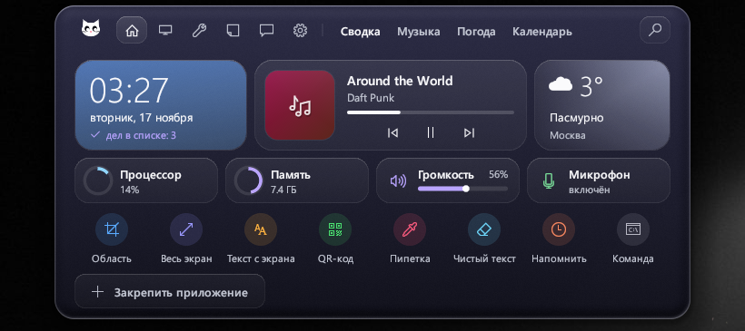
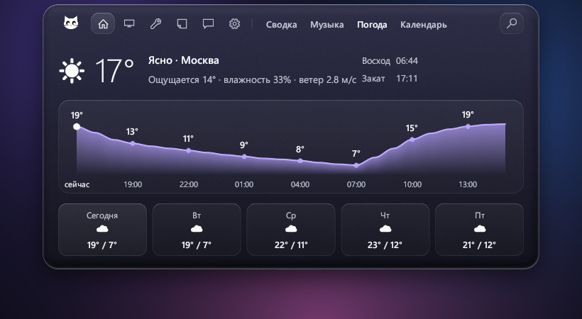
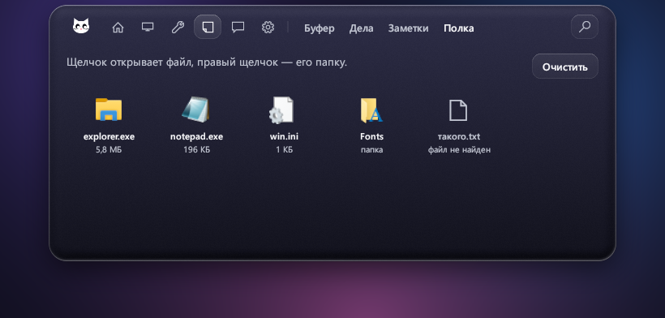

# Островок

Живая панель-остров в верхней части экрана Windows. В свёрнутом виде — маленькая пилюля с часами, погодой и персонажем; при наведении раскрывается в панель с инструментами. Написан на Rust (egui), один исполняемый файл.

**[Страница проекта →](https://qutlawsoasis-debug.github.io/Ostrovok/)**

<p align="center"></p>

В свёрнутом виде остров выглядит так:

<p align="center"></p>

Обновляется он сам — без окон и вопросов, прямо у вас на глазах:

<p align="center"></p>

> Ранняя версия. Основная панель работает, голосовой помощник «Джарвис» — экспериментальный.

## Что умеет

- **Сводка:** время на фоне неба по времени суток, погода, музыка, загрузка процессора и памяти, громкость, закреплённые приложения. Лента дня — сутки полосой с отметкой «сейчас» и сегодняшними напоминаниями. Ряд быстрых действий настраивается: правый щелчок скрывает действие, «+» возвращает.
- **Пилюля:** часы, персонаж и живая погода; значок непрочитанных сообщений, отсчёт за 10 минут до напоминания, батарейка с процентом, когда заряда 20 % и меньше. Название трека, ход воспроизведения и кнопки — под курсором. Меняете громкость или язык ввода — пилюля на секунду показывает шкалу или название раскладки.
- **Погода:** прогноз по часам с графиком температуры, вероятность осадков, восход и закат, дни с диапазоном температур, фаза Луны и долгота дня. Подсказки на ближайшие 12 часов: зонт, непромокаемая обувь, куртка, сильный ветер.
- **Календарь:** выходные цветом, точки по числу дел, праздники России со звёздочкой и названием. По щелчку на день видны его напоминания и можно добавить новое. Под календарём — мировые часы.
- **Музыка:** что сейчас играет, управление, текст песни, перемотка щелчком и перетаскиванием по полосе. Если текста нет — зеркальная звуковая волна в цвет обложки.
- **Живой звук:** эквалайзер в пилюле и на странице музыки показывает настоящий спектр того, что играет на компьютере — даже если плеер не сообщает трек (бот в Discord, игра, видео). Свечение острова пульсирует в такт басу.
- **Звук и система:** громкость по приложениям, кнопка «Тихо» (громкость 20 %, повторный щелчок возвращает прежнюю) и пресеты 25/50/75/100 %, микрофон. Монитор с графиком нагрузки и двумя топами программ — по процессору и по памяти; карточки открывают диспетчер задач и «Память устройства».
- **Управление:** блокировка, сон, перезагрузка, выключение; отложенная блокировка или сон через 15, 30, 60 или 90 минут с отменой.
- **Таймер и «Фокус»:** циферблат с делениями и временем окончания, пауза и продолжение, секундомер, режим 25/5, который сам чередует работу и перерыв, и «Неделя фокуса» с серией дней.
- **Напоминания:** кнопки быстрого времени, повтор каждый день, по будням или каждую неделю; в ночь перевода часов напоминание не теряется.
- **Дела:** срок прямо в тексте («до пятницы», «завтра», «до 5.12»), капсула срока и сортировка по нему, строка прогресса.
- **Заметки и полка:** заметки с чек-листами; полка для файлов — перетащите файл на остров, картинки видны миниатюрами.
- **Умный буфер:** история копирования с поиском, закреплением и миниатюрами картинок. Скопировали ссылку, почту, цвет, пример или иностранную фразу — рядом появляется действие («Открыть», «= 528», «Перевести»). Последнюю запись можно одним щелчком сделать заглавной или строчной, собрать в одну строку, перевести в транслит или исправить раскладку (ghbdtn → привет).
- **Снимки экрана:** после снимка остров показывает миниатюру и действия — скопировать текст с картинки, открыть, показать в папке, положить на полку, удалить. Протяните мышью по миниатюре — появится рамка разметки; результат сохраняется отдельным файлом «(разметка)», исходник не трогается.
- **Инструменты:** текст с экрана, пипетка, QR-код с круглыми точками для ссылки или сети Wi-Fi (пароль хранится только в памяти и стирается, когда уходите со страницы), копирование и сохранение картинки.
- **Уведомления** мессенджеров и завершённых загрузок прямо в пилюле, а пропущенные — списком с фильтром по мессенджеру (хранятся только до перезапуска).
- **Строка поиска:** `Alt + Пробел` (если занято — `Ctrl + Alt + Пробел`). Программы со значками находит и в неправильной раскладке. Понимает быстрые команды: «дело купить хлеб», «заметка …», «напомни 18:30 позвонить», «напомни через 15 мин чай», «таймер 5»; считает «время токио» и «до нового года». В пустом поле — примеры команд и недавние запросы.
- **Конвертер в строке поиска:** «5 км в мили», «72 f в c», «100 usd в рубли» — единицы длины, веса, объёма, данных, времени, скорости, температуры и валюты; без связи честно пишет «нет связи».
- **Темы оформления:** шесть сочетаний цвета акцента и оттенка стекла — Лаванда, Океан, Мята, Закат, Сакура, Графит; при наведении в настройках видно мини-пилюлю с темой.
- **Самообновление:** остров сам находит новую версию в релизах, ставит её и показывает, что изменилось; при сбое откатывается, во время полноэкранной игры ждёт.
- **Джарвис:** голосовой помощник, который сам решает, что сделать на компьютере. См. ниже.

## Быстрые команды и подсказки

Строка поиска открывается по `Alt + Пробел` (если сочетание занято — `Ctrl + Alt + Пробел`). Регистр не важен. Enter выполняет выбранную строку; у ответов (время, дата, пример, перевод единиц) Enter копирует результат. Примеры с датами и временем посчитаны для вторника, 17 ноября 2026, 15:00 по Москве.

### Быстрые команды

| Команда | Пример | Что будет |
|---|---|---|
| `дело …` / `todo …` | `дело купить хлеб` | Добавить дело: купить хлеб |
| `заметка …` / `note …` | `заметка идея: тёмная тема` | Новая заметка: идея: тёмная тема |
| `напомни` (`напомнить`, `напомни мне`) + время `ЧЧ:ММ` или `ЧЧ.ММ`, можно с «в», в любом месте фразы | `напомни 18:30 позвонить маме`, `напомни позвонить маме в 18:30` | Напомнить сегодня в 18:30: позвонить маме |
| то же, если время уже прошло | `напомни 9:00 зарядка` | Напомнить завтра в 09:00: зарядка |
| `напомни … через N мин / м / ч` (`через час` — это 1 час, дробное `1,5 часа` тоже можно) | `напомни через 15 мин чай`, `напомни выключить духовку через 2 часа` | Напомнить сегодня в 15:15: чай / в 17:00: выключить духовку |
| `таймер N` / `timer N` — минуты, можно дробные, не больше 1440 | `таймер 5`, `timer 2,5` | Таймер на 5 мин / Таймер на 2.5 мин |

Напоминанию нужен текст: «напомни 18:30» без дела не сработает. Срок «через …» — только минуты и часы, от 1 минуты до года; «завтра», дни недели и «полчаса» команда не разбирает. Таймер понимает только число минут: «таймер 5 мин» или «таймер 1:30» не сработают. Дела, заметки и напоминания в «Недавнее» не попадают.

### Даты и время

| Запрос | Пример | Ответ |
|---|---|---|
| `через N дней / недель / месяцев / лет` (без числа — 1) | `через 45 дней`, `через 3 недели` | 1 января 2027, пятница / 8 декабря 2026, вторник |
| `до нового года` (`до нг`) | `до нового года` | через 45 дней (6 нед. 3 дн.) · 1 января 2027, пятница |
| `до ДД.ММ[.ГГГГ]`, `до 8 марта [2027]` | `до 31.12`, `до 8 марта` | через 44 дня (6 нед. 2 дн.) · 31 декабря 2026, четверг / через 111 дней (15 нед. 6 дн.) · 8 марта 2027, понедельник |
| просто дата `ДД.ММ` или `ДД.ММ.ГГГГ` | `15.02.2027`, `15.11.2026` | 15 февраля 2027, понедельник · через 90 дней / … · 2 дня назад |
| `время <город>` / `time <город>` | `время токио`, `time new york` | Токио — 21:00 (+6 ч) / Нью-Йорк — 07:00 (−8 ч) |

Enter у даты копирует её в виде `ДД.ММ.ГГГГ`. Если год не указан, берётся ближайшая такая дата — сегодня или позже. Без года месяц пишется двумя цифрами (`до 5.12` — дата, `12.5` — число), название месяца — в родительном падеже («марта»). Несуществующие даты («31.02») не понимает. Разница во времени считается от часов вашего компьютера.

Города: Москва (мск), Петербург (питер, spb), Калининград, Екатеринбург, Новосибирск, Владивосток, Киев, Минск, Алматы, Ташкент, Тбилиси, Стамбул, Дубай, Лондон, Берлин, Париж, Варшава, Дели (мумбаи), Пекин (шанхай), Токио, Сеул, Сидней (мельбурн), Нью-Йорк (nyc), Чикаго, Лос-Анджелес (la), Торонто, UTC (gmt).

Название города пишется целиком, можно по-английски (`tokyo`, `london`). Летнее время учитывается; если там уже другой день, в ответе видно «· завтра» или «· вчера».

### Конвертер единиц

Пишите `число единица [в | to | in | = | →] единица`: `5 км в мили`, `5км`, `1 000 м в км`, `2,5 кг в фунты`. Если цель не указана, остров выберет её сам: `5 км` — в мили, `0 c` — в °F.

| Группа | Как писать |
|---|---|
| Длина | мм, см, м, км, in (`"`), ft (`'`), yd, mi; миллиметры, сантиметры, метры, километры, дюймы, футы, ярды, мили |
| Масса | мг, г (гр), кг, т, lb, oz; граммы, килограммы, тонны, фунты, унции |
| Объём | мл, л, gal; литры, галлоны |
| Данные (1 КБ = 1024 байта) | б, кб, мб, гб, тб, kb, mb, gb, tb; байты, мегабайты, гигабайты, терабайты |
| Время | с (сек), мин, ч, д (дн), нед; секунды, минуты, часы, дней (дня), сутки, недели |
| Скорость | км/ч (kmh), м/с (m/s), mph |
| Температура | c, °c, ц; f, ф; k, к; цельсий, градусы, фаренгейт, кельвин |

Примеры: `5 км в мили` → 5 км = 3,107 миль · `10 дюймов в см` → 25,4 см · `500 мл в л` → 500 мл = 0,5 л · `1 гб в мб` → 1 024 МБ · `90 минут в часы` → 1,5 ч · `100 км/ч в м/с` → 27,778 м/с · `72 f в c` → 22,222 °C · `300 кельвинов в цельсии` → 26,85 °C.

Разные группы не смешиваются (`5 км в кг` — ничего). Градусы Цельсия — латинская `c` или `ц`: русская `с` означает секунды. Для мг, мл и кб пишите только сокращения.

### Валюты

USD ($, доллары, баксы), EUR (€, евро), RUB (₽, руб, р, рубли), UAH (₴, грн, гривны), GBP (£), JPY (¥, иены), KZT (₸, тг, тенге), BYN, CNY (юани), PLN (zł, злотые), TRY (₺, лиры), CHF (франки), CZK (кроны), GEL (лари), AMD (драмы).

`100 usd в рубли`, `$50 в евро`, `1000 рублей в доллары`; при курсе 80 ответ выглядит так: 100 USD = 8 000 RUB. `10 евро` без цели — сразу в доллары, рубли и гривны. Курсы приходят с open.er-api.com раз в 12 часов и сохраняются на диск; без связи и без сохранённых курсов остров пишет «Нет связи — курсы валют недоступны». Валюты в единицы не переводятся.

### Калькулятор

Цифры, `+ - * /`, скобки, дробь через точку или запятую: `2+2` → = 4, `(1+2)*3` → = 9, `10/3` → = 3.333333, `1,5*2` → = 3. Enter копирует ответ. Степени, проценты и `×` калькулятор не понимает; деление на ноль ничего не выдаёт.

### Программы, сайты и раскладка

- Программы ищутся по ярлыкам из меню «Пуск» и с рабочего стола: сначала по началу названия, потом по началу слова, потом по любой части; показывается до пяти.
- Набрали в другой раскладке — тоже найдёт: `тщеузфв` → Notepad (такие совпадения идут ниже обычных).
- Адрес без пробелов с точкой открывается как сайт: `youtube.com`.
- Внизу списка — «Искать «…» в интернете» и «Спросить ИИ». «Спросить ИИ» не показывается, если запрос уже стал командой, примером или переводом единиц.
- В пустом поле — примеры команд и «Недавнее»: последние пять запусков (программы, сайты, ответы, таймеры). Вопросы ИИ и текст, вставленный из буфера, туда не попадают. Крестик очищает список.

### Умный буфер — подсказки

Скопируйте одну строку — остров на 8 секунд покажет у пилюли действие; в разделе «Буфер» действие стоит у каждой записи. Сам он ничего не открывает — только по щелчку.

| Скопировали | Пример | Действие |
|---|---|---|
| Ссылку | `https://example.org`, `www.example.org` | Открыть ссылку |
| Почту | `name@mail.ru` | Написать письмо |
| Цвет | `#ff8800`, `#fa0` | rgb(255, 136, 0) / rgb(255, 170, 0) — щелчок копирует |
| Путь к файлу или папке | `C:\Windows\notepad.exe` | Открыть папку |
| Пример | `12*3`, `100 - 15` | = 36 / = 85 — щелчок копирует ответ |
| Текст не в той раскладке | `ghbdtn, rfr ltkf?` | → привет, как дела? — щелчок копирует |
| Фразу на другом языке | `good morning everyone` | Перевести (Google Переводчик) |

Вычитание пишите с пробелами (`100 - 15`): `100-15` похоже на телефон или дату и подсказки не получит. Многострочный текст подсказок не даёт.

### Умный буфер — преобразования

Над историей в разделе «Буфер» есть строка «Последнее:» — кнопки для последней скопированной записи. Результат сразу оказывается в буфере. Если от кнопки текст не изменится, она неактивна.

| Кнопка | Было → стало |
|---|---|
| ВЕРХНИЙ | Привет, world → ПРИВЕТ, WORLD |
| нижний | ПРИВЕТ, World → привет, world |
| Одной строкой | несколько строк и лишние пробелы → первая вторая третья |
| Транслит | Щука ёж, Юля! → Shchuka yozh, Yulya! · ЖУК → ZHUK |
| Раскладка | ghbdtn, vbh! → привет, мир! · руддщ цщкдв → hello world |

## Как это выглядит

| | |
|---|---|
|  Погода по часам |  Монитор: нагрузка, сеть, память |
|  Громкость каждой программы |  Таймер, «Фокус 25/5», секундомер |
|  Список дел |  Полка для файлов |
|  Календарь с делами |  Громкость всплывает в пилюле |

## Установка

1. Скачайте `Ostrovok.exe` со страницы [релизов](../../releases) и запустите.
2. В настройках нажмите «Установить» (или запустите `Ostrovok.exe --install`): остров переедет в `%LOCALAPPDATA%\Programs\Ostrovok`, появится в меню «Пуск», автозапуск переедет вместе с ним. Права администратора не нужны, скачанный файл после этого можно удалить.
3. Настройки хранятся в `%APPDATA%\Ostrovok`. Автозапуск включается переключателем в настройках. Дальше остров обновляется сам.

**Предупреждение антивируса.** Защитник Windows может назвать файл подозрительным (`Trojan:Win32/Bearfoos.A!ml` или похоже). Это ложное срабатывание автоматики на новую программу без цифровой подписи, которая читает буфер обмена, делает снимки экрана и слушает микрофон. Исходный код открыт — можно проверить и собрать самому.

## Джарвис

Помощник понимает просьбы своими словами и выполняет их сам: открывает программы, сайты и папки, меняет громкость, ставит таймеры и напоминания, читает буфер обмена и текст с экрана, ищет файлы, выполняет команды PowerShell. Необратимые действия (команды, выключение) сначала спрашивают разрешения.

Всё работает на вашем компьютере, без ключей и подписок:

| Часть | Чем сделано | Размер |
|---|---|---|
| Мозг | [llama.cpp](https://github.com/ggml-org/llama.cpp) + модель Qwen3 | 0,4 / 1 / 2,4 ГБ на выбор |
| Слух | [sherpa-onnx](https://github.com/k2-fsa/sherpa-onnx) + [GigaAM](https://github.com/salute-developers/GigaAM) (русская речь) | ~250 МБ |
| Голос | [Piper](https://github.com/rhasspy/piper), голос «Ирина» | ~90 МБ |

### Как включить

Откройте **ИИ → Джарвис**, выберите размер модели и нажмите «Скачать и включить». Остров сам загрузит всё нужное в `%APPDATA%\Ostrovok\jarvis` и покажет ход загрузки: около 2,6 ГБ с большой моделью, около 1,3 ГБ со средней. Другие модели можно докачать позже в настройках Джарвиса.

### Как пользоваться

- Напишите просьбу в поле или нажмите **«Говорить»** и скажите её вслух.
- **«Слово „Джарвис“»** — постоянное прослушивание: остров откликается на фразы со своим именем без нажатий. По умолчанию выключено.
- Модель загружается в память только на время разговора и выгружается через полторы минуты тишины.

### Необязательно: облачный мозг и свой голос

В настройках Джарвиса (кнопка «Настройки» на его странице) можно указать:

- **Облачный мозг** — адрес любого сервера с протоколом чата OpenAI, ключ и имя модели. Тогда думает он, память компьютера не занята, а локальная модель остаётся запасной. Пример посредника со своим ключом — в [`relay/worker.js`](relay/worker.js).
- **Свой голос Fish Audio** — ключ и номер голоса вместо встроенного.

## Что уходит в интернет

Островок ничего не отправляет разработчику. Наружу идут только эти запросы — каждый вы запускаете сами или можете выключить:

- город и его координаты — на open-meteo.com, если вы указали город для погоды;
- запрос свежих курсов валют — на open.er-api.com, когда вы спрашиваете про валюту в строке поиска (курсы: [Exchange Rate API](https://www.exchangerate-api.com)); сам запрос и суммы никуда не уходят;
- исполнитель и название трека — на lrclib.net, если включён текст песен;
- проверка обновлений — в релизы на GitHub, раз в минуту; выключается в настройках («Обновляться автоматически»);
- переписка во вкладке «ИИ» — в выбранный вами сервис;
- вопросы и ответы Джарвиса, а также то, что он прочитал по вашей просьбе (например, буфер обмена), — только если вы указали облачный мозг или голос Fish Audio;
- модели Джарвиса скачиваются с GitHub и Hugging Face, когда вы сами запускаете установку;
- фраза для перевода открывается в Google Переводчике, только когда вы нажмёте «Перевести».

Звук компьютера для эквалайзера анализируется на месте и никуда не пишется. Речь с микрофона распознаётся на компьютере. В режиме постоянного прослушивания фразы без слова «Джарвис» сразу отбрасываются и нигде не сохраняются.

## Сборка из исходников

Нужен [Rust](https://rustup.rs) (stable, MSVC).

```bash
cargo build --release
```

Готовый файл — `target\release\ostrovok.exe`.

## Требования

Windows 10 или 11, 64 бита. Для Джарвиса — 8 ГБ памяти; видеокарта ускоряет ответы, но не обязательна.
