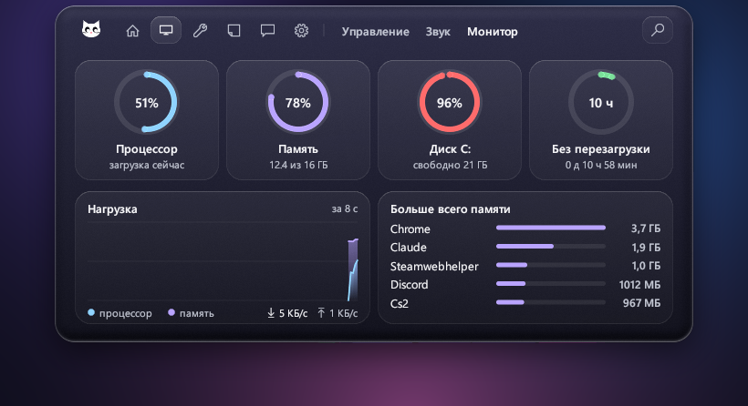
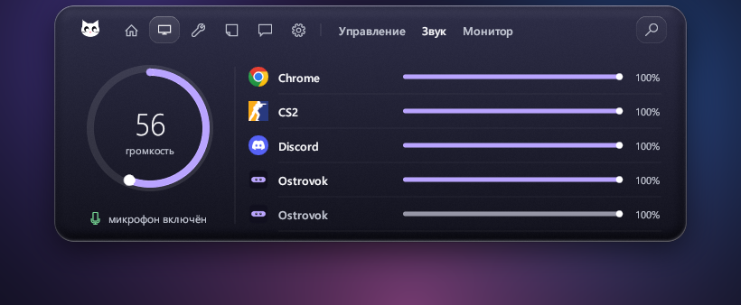
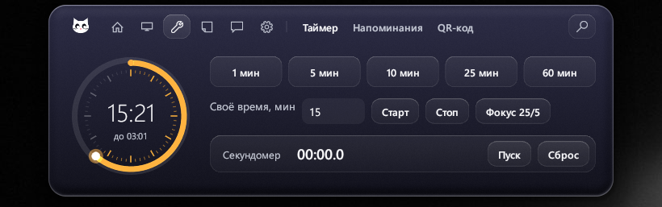
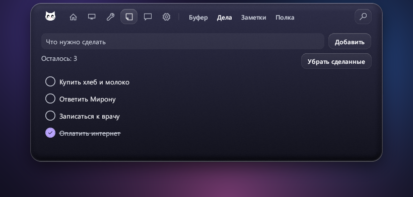
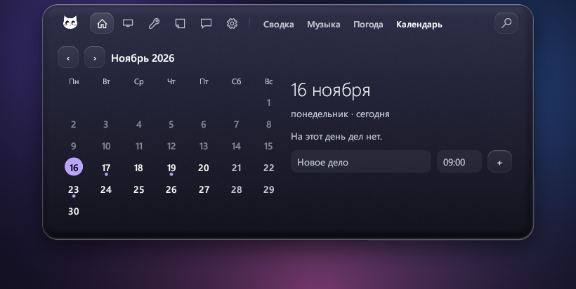

# Островок

Живая панель-остров в верхней части экрана Windows. В свёрнутом виде — маленькая пилюля с часами, погодой и персонажем; при наведении раскрывается в панель с инструментами. Написан на Rust (egui), один исполняемый файл.

**[Страница проекта →](https://qutlawsoasis-debug.github.io/Ostrovok/)**

<p align="center"></p>

В свёрнутом виде остров выглядит так:

<p align="center"></p>

Обновляется он сам — без окон и вопросов, прямо у вас на глазах:

<p align="center"></p>

> Ранняя версия. Основная панель работает, голосовой помощник «Джарвис» — экспериментальный.

## Что умеет

- **Погода:** прогноз по часам с графиком температуры, вероятность осадков, восход и закат, пять дней вперёд.
- **Календарь:** дни с делами отмечены, по щелчку на день видны его напоминания и можно добавить новое на эту дату.
- **Сводка:** время, погода, музыка, загрузка процессора и памяти, громкость, быстрые действия, закреплённые приложения.
- **Музыка:** что сейчас играет, управление, текст песни.
- **Живой звук:** эквалайзер в пилюле и на странице музыки показывает настоящий спектр того, что играет на компьютере — даже если плеер не сообщает трек (бот в Discord, игра, видео). Свечение острова пульсирует в такт басу.
- **Система:** громкость по приложениям, микрофон, питание; монитор с графиком нагрузки и списком программ, которые занимают больше всего памяти.
- **Инструменты:** снимки экрана, текст с экрана, пипетка, QR-код, таймер и секундомер, напоминания.
- **Записи:** история буфера обмена с поиском и закреплением, заметки, полка для файлов.
- **Темы оформления:** шесть сочетаний цвета акцента и оттенка стекла — Лаванда, Океан, Мята, Закат, Сакура, Графит.
- **Умный буфер:** скопировали ссылку, почту, цвет, пример или фразу на иностранном языке — рядом с островом появляется действие («Открыть», «= 528», «Перевести»).
- **Уведомления** мессенджеров и завершённых загрузок прямо в пилюле, а пропущенные — списком на странице «Уведомления» (хранятся только до перезапуска).
- **Конвертер в строке поиска:** «5 км в мили», «72 f в c», «100 usd в рубли» — единицы длины, веса, объёма, данных, времени, скорости, температуры и валюты.
- **Карточка снимка экрана:** после снимка остров показывает миниатюру и действия — скопировать текст с картинки, открыть, показать в папке, положить на полку, удалить.
- **Музыка в пилюле:** название трека, ход воспроизведения и кнопки управления под курсором.
- **Громкость и раскладка:** меняете громкость или язык ввода — пилюля на секунду показывает шкалу или название раскладки.
- **Дела и «Фокус»:** список дел с галочками и таймер 25/5, который сам чередует работу и перерыв.
- **Самообновление:** остров сам находит новую версию в релизах, ставит её и показывает, что изменилось.
- **Командная строка острова:** `Alt + Пробел` (если занято — `Ctrl + Alt + Пробел`).
- **Джарвис:** голосовой помощник, который сам решает, что сделать на компьютере. См. ниже.

## Как это выглядит

| | |
|---|---|
|  Погода по часам |  Монитор: нагрузка, сеть, память |
|  Громкость каждой программы |  Таймер, «Фокус 25/5», секундомер |
|  Список дел |  Полка для файлов |
|  Календарь с делами |  Громкость всплывает в пилюле |

## Установка

1. Скачайте `Ostrovok.exe` со страницы [релизов](../../releases) и запустите.
2. В настройках нажмите «Установить» (или запустите `Ostrovok.exe --install`): остров переедет в `%LOCALAPPDATA%\Programs\Ostrovok`, появится в меню «Пуск», автозапуск переедет вместе с ним. Права администратора не нужны, скачанный файл после этого можно удалить.
3. Настройки хранятся в `%APPDATA%\Ostrovok`. Автозапуск включается переключателем в настройках. Дальше остров обновляется сам.

**Предупреждение антивируса.** Защитник Windows может назвать файл подозрительным (`Trojan:Win32/Bearfoos.A!ml` или похоже). Это ложное срабатывание автоматики на новую программу без цифровой подписи, которая читает буфер обмена, делает снимки экрана и слушает микрофон. Исходный код открыт — можно проверить и собрать самому.

## Джарвис

Помощник понимает просьбы своими словами и выполняет их сам: открывает программы, сайты и папки, меняет громкость, ставит таймеры и напоминания, читает буфер обмена и текст с экрана, ищет файлы, выполняет команды PowerShell. Необратимые действия (команды, выключение) сначала спрашивают разрешения.

Всё работает на вашем компьютере, без ключей и подписок:

| Часть | Чем сделано | Размер |
|---|---|---|
| Мозг | [llama.cpp](https://github.com/ggml-org/llama.cpp) + модель Qwen3 | 0,4 / 1 / 2,4 ГБ на выбор |
| Слух | [sherpa-onnx](https://github.com/k2-fsa/sherpa-onnx) + [GigaAM](https://github.com/salute-developers/GigaAM) (русская речь) | ~250 МБ |
| Голос | [Piper](https://github.com/rhasspy/piper), голос «Ирина» | ~90 МБ |

### Как включить

Откройте **ИИ → Джарвис**, выберите размер модели и нажмите «Скачать и включить». Остров сам загрузит всё нужное в `%APPDATA%\Ostrovok\jarvis` и покажет ход загрузки: около 2,6 ГБ с большой моделью, около 1,3 ГБ со средней. Другие модели можно докачать позже в настройках Джарвиса.

### Как пользоваться

- Напишите просьбу в поле или нажмите **«Говорить»** и скажите её вслух.
- **«Слово „Джарвис“»** — постоянное прослушивание: остров откликается на фразы со своим именем без нажатий. По умолчанию выключено.
- Модель загружается в память только на время разговора и выгружается через полторы минуты тишины.

### Необязательно: облачный мозг и свой голос

В настройках Джарвиса (кнопка «Настройки» на его странице) можно указать:

- **Облачный мозг** — адрес любого сервера с протоколом чата OpenAI, ключ и имя модели. Тогда думает он, память компьютера не занята, а локальная модель остаётся запасной. Пример посредника со своим ключом — в [`relay/worker.js`](relay/worker.js).
- **Свой голос Fish Audio** — ключ и номер голоса вместо встроенного.

## Что уходит в интернет

Островок ничего не отправляет разработчику. Наружу идут только запросы, которые вы сами включили:

- название города — на open-meteo.com (погода);
- запрос курсов валют — на open.er-api.com, когда вы спрашиваете про валюту в строке поиска (курсы: [Exchange Rate API](https://www.exchangerate-api.com)); сам запрос и суммы никуда не уходят;
- название трека — на lrclib.net, если включён текст песен;
- переписка во вкладке «ИИ» — в выбранный вами сервис;
- вопросы и ответы Джарвиса — только если вы указали облачный мозг или голос Fish Audio.

Звук компьютера для эквалайзера анализируется на месте и никуда не пишется. Речь с микрофона распознаётся на компьютере. В режиме постоянного прослушивания фразы без слова «Джарвис» сразу отбрасываются и нигде не сохраняются.

## Сборка из исходников

Нужен [Rust](https://rustup.rs) (stable, MSVC).

```bash
cargo build --release
```

Готовый файл — `target\release\ostrovok.exe`.

## Требования

Windows 10 или 11, 64 бита. Для Джарвиса — 8 ГБ памяти; видеокарта ускоряет ответы, но не обязательна.
